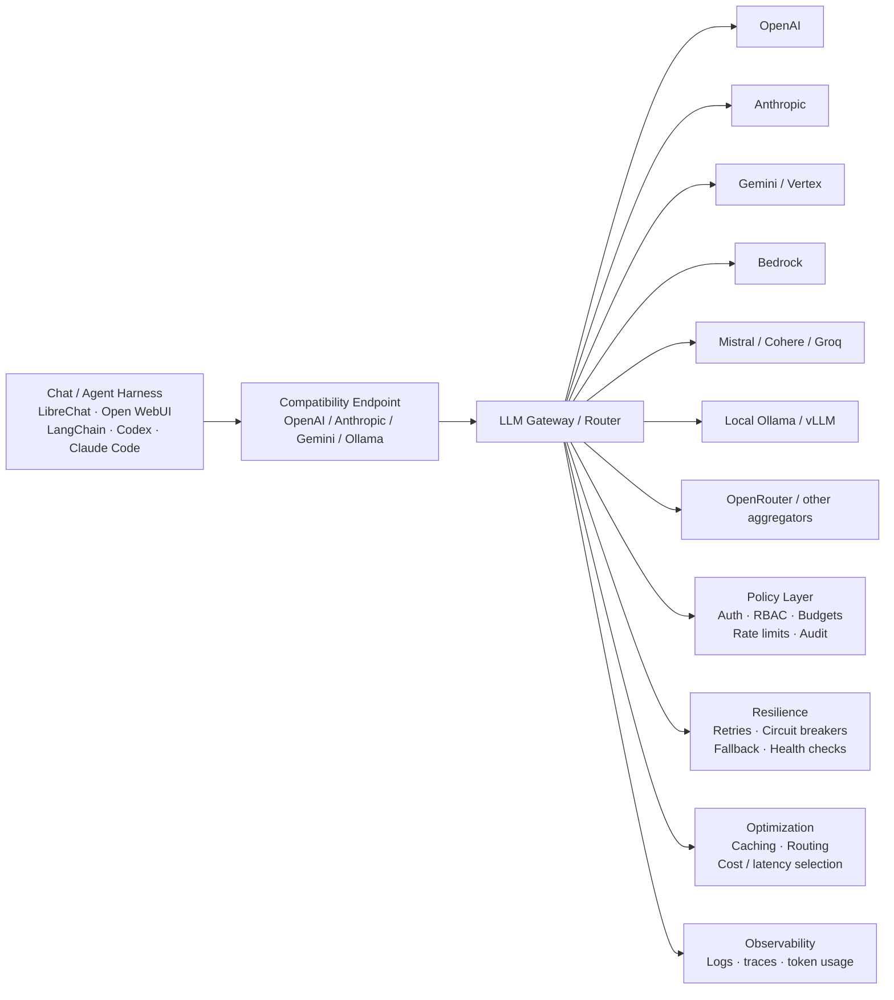
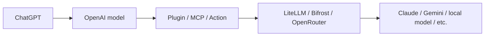
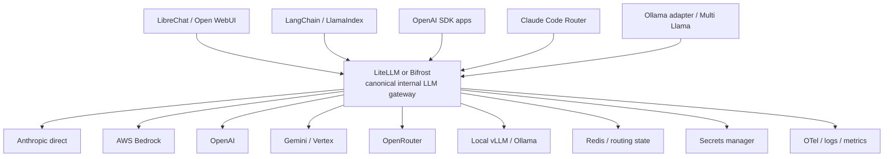

# Multi-Provider LLM API Proxies, Gateways, Load Balancers, and Harness Adapters

## Executive summary

The ecosystem has matured substantially: there are now several credible ways to put **one API endpoint in front of OpenAI, Anthropic, Google/Gemini, Azure OpenAI, AWS Bedrock, Mistral, Cohere, Groq, DeepSeek, OpenRouter, local Ollama/vLLM servers, and other OpenAI-compatible endpoints**, while adding provider translation, load balancing, failover, quotas, caching, authentication, observability, and tenant controls. The strongest general-purpose options today are **[LiteLLM](https://github.com/BerriAI/litellm)**, **[Bifrost](https://github.com/maximhq/bifrost)**, **[Portkey Gateway](https://github.com/Portkey-AI/gateway)**, **[Kong AI Gateway](https://developer.konghq.com/ai-gateway/)**, **[Apache APISIX AI Gateway](https://apisix.apache.org/ai-gateway/)**, **[Agent Router](https://github.com/theagentrouter/agent-router)**, and managed services such as **[OpenRouter](https://openrouter.ai/)**, **[Vercel AI Gateway](https://vercel.com/ai/gateway)** and **[Cloudflare AI Gateway](https://developers.cloudflare.com/ai-gateway/)**. citeturn614349search6turn598393search13turn614349search8turn243930search2turn769142search6turn598393search12turn454933search7turn243930search15

For the specific goal of **making a client believe it is talking to OpenAI, Anthropic, Gemini or Ollama while actually routing elsewhere**, a second category matters just as much: protocol adapters such as **[Claude Code Router](https://github.com/musistudio/claude-code-router)**, **[CLIProxyAPI](https://github.com/router-for-me/CLIProxyAPI)**, **[Multi Llama](https://github.com/diegodurrod/multi-llama)**, **[New API](https://github.com/QuantumNous/new-api)** and **[One API](https://github.com/songquanpeng/one-api)**. Claude Code Router speaks OpenAI Chat, OpenAI Responses, Anthropic Messages and Gemini protocols and can point coding harnesses such as Claude Code and Codex at alternative backends; CLIProxyAPI additionally exposes OAuth-backed coding-CLI accounts through OpenAI/Gemini/Claude-compatible interfaces; Multi Llama explicitly exposes both Ollama- and OpenAI-compatible APIs. citeturn281688search0turn281688search2turn281688search3turn491026search0turn491026search2

The major caveat is **ChatGPT itself**. OpenAI currently documents plugins, connected apps, MCP servers and GPT actions as mechanisms for ChatGPT to call external services, but does **not document a supported setting that replaces ChatGPT's underlying inference endpoint with an arbitrary OpenAI-compatible server**. The practical conclusion is that a LiteLLM/OpenRouter/Bifrost endpoint can be exposed to ChatGPT as a tool or plugin, but it does not become ChatGPT's core model. Browser/network interception could theoretically rewrite private ChatGPT traffic, but that is an unsupported, fragile approach and should not be treated as a production integration. This conclusion is an inference from the currently documented ChatGPT integration surface. citeturn614349search0turn614349search1turn614349search3

If the requirement is instead **“a ChatGPT-like UI where I can select any provider”**, the cleanest architecture is to use **[Open WebUI](https://docs.openwebui.com/)**, **[LibreChat](https://www.librechat.ai/)** or another configurable frontend and connect it to one of these gateways. Open WebUI supports Ollama and multiple OpenAI-compatible connections; LibreChat explicitly supports custom OpenAI-compatible and Anthropic-compatible endpoints, including LiteLLM, OpenRouter, Portkey, Helicone and vLLM. citeturn281688search5turn281688search6turn793870search0turn793870search2

The assumptions for this analysis are that there is no fixed budget, no mandated cloud, self-hosting is acceptable, Kubernetes may be available but is not required, and the desired design should handle both commercial APIs and local models.

## How the ecosystem fits together

It is useful to separate five things that are often all called an “LLM proxy”:

| Layer | Purpose | Examples |
|---|---|---|
| Protocol adapter | Make Anthropic/Gemini/Ollama/etc. look like another API | Claude Code Router, CLIProxyAPI, Multi Llama |
| LLM gateway | One endpoint, auth, provider normalization, policy | LiteLLM, Bifrost, Portkey, Helicone |
| LLM router | Choose provider/model dynamically | LiteLLM Router, OpenRouter routing, Vercel Gateway |
| Enterprise API gateway with AI features | Governance plus general API management | Kong, APISIX, Azure APIM, Gloo |
| Chat/agent harness | The application consuming the gateway | Open WebUI, LibreChat, LangChain, LlamaIndex, Claude Code, Codex |

A robust deployment therefore usually looks like this:



The **OpenAI-compatible API has become the de-facto interchange format**, because the OpenAI SDK itself supports overriding `base_url`, and many frameworks expose a similar configuration. OpenAI's official Python library supports a custom `base_url` or the `OPENAI_BASE_URL` environment variable. citeturn614349search5 This explains why a large proportion of the ecosystem simply asks you to replace:

```text
https://api.openai.com/v1
```

with:

```text
https://your-gateway.example/v1
```

That approach is easy, but compatibility is not perfect. Differences increasingly matter around the **Responses API, reasoning state, tool calls, structured output, multimodal messages, prompt caching and provider-specific metadata**. LangChain explicitly warns that `ChatOpenAI` targets the official OpenAI specification and that provider-specific fields may be lost when pointing it at non-OpenAI servers. citeturn545538search0

## Solution inventory

### General-purpose and enterprise gateways

| Project | Type | Providers / protocol | Main strengths | License / pricing | Links |
|---|---|---|---|---|---|
| **[LiteLLM](https://www.litellm.ai/)** | OSS self-hosted + Enterprise | 100+ provider/model integrations; OpenAI-compatible gateway | Extremely broad provider support; virtual keys; budgets; routing; fallbacks; Redis-backed distributed routing; Kubernetes | MIT OSS; self-host free; Enterprise annual capacity-based license | [GitHub](https://github.com/BerriAI/litellm) · [Docs](https://docs.litellm.ai/) · [Routing](https://docs.litellm.ai/docs/routing) · [Pricing](https://www.litellm.ai/pricing) |
| **[Bifrost](https://www.getmaxim.ai/bifrost)** | OSS gateway | OpenAI, Anthropic, Bedrock, Vertex, Azure and many others | Very fast Go implementation; OpenAI/Anthropic compatibility; load balancing; virtual keys; semantic cache; budgets; MCP | Apache-2.0 OSS; enterprise capabilities also available | [GitHub](https://github.com/maximhq/bifrost) · [Docs](https://docs.getbifrost.ai/) |
| **[Portkey Gateway](https://portkey.ai/features/ai-gateway)** | OSS + hosted/enterprise | Claims 1,600+ models | Rich retries/fallback/load balancing, caching, guardrails, observability, virtual keys | Gateway repository MIT; hosted/enterprise plans | [GitHub](https://github.com/Portkey-AI/gateway) · [Docs](https://portkey.ai/docs) · [Pricing](https://portkey.ai/pricing) |
| **[Helicone AI Gateway](https://docs.helicone.ai/ai-gateway)** | OSS + hosted | OpenAI, Anthropic, Google, Bedrock and 20+ providers | Routing + strong observability; low-overhead gateway; latency routing; rate limits | See licensing caveat below | [Gateway GitHub](https://github.com/Helicone/ai-gateway) · [Platform GitHub](https://github.com/Helicone/helicone) · [Docs](https://docs.helicone.ai/) · [Pricing](https://www.helicone.ai/pricing) |
| **[TensorZero](https://www.tensorzero.com/)** | OSS LLMOps stack | Major providers + arbitrary OpenAI-compatible APIs | Gateway integrated with experimentation, evaluation and optimization | Apache-2.0 | [GitHub](https://github.com/tensorzero/tensorzero) · [Gateway Docs](https://www.tensorzero.com/docs/gateway) |
| **[Agent Router](https://theagentrouter.ai/)** | OSS Kubernetes/Envoy gateway | OpenAI-compatible + Anthropic-compatible and provider integrations | Kubernetes-native, Envoy data plane, centralized provider credentials, quotas, routing | Apache-2.0 | [GitHub](https://github.com/theagentrouter/agent-router) · [Site/Docs](https://theagentrouter.ai/) |
| **[Apache APISIX AI Gateway](https://apisix.apache.org/ai-gateway/)** | OSS API gateway | OpenAI, DeepSeek, Azure, Anthropic, OpenRouter, Gemini, Vertex, Bedrock, OpenAI-compatible | Weighted routing, priority, retries, active health checks, semantic routing; mature API-gateway ecosystem | Apache-2.0 project | [GitHub](https://github.com/apache/apisix) · [`ai-proxy-multi`](https://apisix.apache.org/docs/apisix/plugins/ai-proxy-multi/) |
| **[Kong AI Gateway](https://developer.konghq.com/ai-gateway/)** | Enterprise API/AI gateway | Multiple commercial/cloud providers | One of the richest policy engines: round-robin, consistent hash, least-connections, lowest latency/usage, semantic and priority routing; semantic cache; governance | Commercial Konnect/Gateway Enterprise; self-host Enterprise custom pricing | [Docs](https://developer.konghq.com/ai-gateway/) · [Load balancing](https://developer.konghq.com/ai-gateway/load-balancing/) · [Pricing](https://www.konghq.com/pricing) |
| **[Azure API Management AI Gateway](https://learn.microsoft.com/en-us/azure/api-management/genai-gateway-capabilities)** | Managed + self-hosted APIM gateway | Azure OpenAI/Foundry plus compatible external endpoints | Enterprise Azure identity/networking; token quotas; semantic caching; backend pools; circuit breaking | Azure APIM consumption/tier pricing | [Docs](https://learn.microsoft.com/en-us/azure/api-management/genai-gateway-capabilities) · [Architecture](https://learn.microsoft.com/en-us/azure/architecture/ai-ml/guide/azure-openai-gateway-multi-backend) |
| **[Gloo AI Gateway](https://docs.solo.io/gateway/1.21.x/ai/overview/)** | Enterprise Kubernetes gateway | OpenAI, Anthropic, Gemini, Mistral, Azure OpenAI and others | Envoy/Kubernetes networking, enterprise gateway policy | Enterprise AI Gateway add-on | [Docs](https://docs.solo.io/gateway/1.21.x/ai/overview/) · [Providers](https://docs.solo.io/gateway/1.21.x/ai/guides/cloud-providers/) |

LiteLLM offers weighted/random, rate-limit-aware, latency-based, least-busy, custom and lowest-cost routing, with Redis used to coordinate routing state across replicas. citeturn614349search6turn137171search21 Bifrost advertises 23+ providers and sub-millisecond gateway overhead, while its repository is Apache-2.0 licensed. citeturn137171search25turn598393search13 Portkey supports weighted load balancing, automatic retries and configurable fallbacks, and its gateway code is MIT licensed. citeturn614349search8turn454933search1

Kong currently exposes one of the broadest router menus: `round-robin`, `consistent-hashing`, `least-connections`, `lowest-latency`, `lowest-usage`, semantic routing and priority/failover. citeturn243930search0turn243930search1 Apache APISIX's `ai-proxy-multi` can perform weighted round-robin, consistent hashing and semantic routing, along with retries, priority/fallback and active health checks. citeturn769142search0turn769142search1

A licensing detail worth flagging: the current Helicone AI Gateway repository presents conflicting metadata. Its README describes the gateway as Apache-licensed, while GitHub's repository license metadata and the checked-in `LICENSE` content identify GPL-3.0 text. Organizations with strict OSS policies should inspect the repository commit they intend to deploy rather than relying on the README badge. citeturn535921view0turn535921view1

### Managed aggregators and provider-routing services

| Service | Routing model | Key characteristics | Pricing model | Links |
|---|---|---|---|---|
| **[OpenRouter](https://openrouter.ai/)** | Provider + model routing | Single OpenAI-compatible endpoint; many providers; dynamic cost/throughput/TTFT/reliability routing; provider and model fallback | Provider list-price inference; credit-purchase fees depending on plan; BYOK available | [Docs](https://openrouter.ai/docs) · [Provider routing](https://openrouter.ai/docs/guides/routing/provider-selection) · [Pricing](https://openrouter.ai/pricing) |
| **[Vercel AI Gateway](https://vercel.com/ai/gateway)** | Provider routing | Dynamic provider choice using availability/latency; explicit provider order; model fallbacks; cost/TTFT/TPS sorting | Provider list prices, zero markup according to current pricing docs; $5 starting credit noted by docs | [Docs](https://vercel.com/docs/ai-gateway) · [Routing](https://vercel.com/docs/ai-gateway/models-and-providers/provider-options) · [Pricing](https://vercel.com/docs/ai-gateway/pricing) |
| **[Cloudflare AI Gateway](https://developers.cloudflare.com/ai-gateway/)** | Gateway + dynamic routes | Logging, cache, rate limits, retries, model fallback, custom providers, unified billing, Cloudflare edge | Core gateway features currently described as free; provider inference passed through; logging/adjacent services may incur cost | [Docs](https://developers.cloudflare.com/ai-gateway/) · [Request handling](https://developers.cloudflare.com/ai-gateway/configuration/request-handling/) · [Pricing](https://developers.cloudflare.com/ai-gateway/reference/pricing/) |

OpenRouter's routing engine incorporates effective price, throughput, TTFT, rate limits, reliability and tool-call quality from recent production traffic, and automatically retains other providers as fallbacks unless routing is constrained. citeturn454933search11turn454933search12 Vercel can sort candidate providers by cost, TTFT or output tokens per second, or respect an explicit ordered list, and falls through alternative providers when one fails. citeturn454933search7turn454933search9 Cloudflare supports retries, fallback, caching, rate limiting, spend limits and arbitrary custom HTTPS providers. citeturn243930search17turn243930search18turn243930search20

### Harness-specific adapters and “API impersonators”

These are particularly relevant when the application insists on a specific vendor protocol.

| Project | Client-facing APIs | Upstreams / use | Routing | Links |
|---|---|---|---|---|
| **[Claude Code Router](https://github.com/musistudio/claude-code-router)** | OpenAI Chat, OpenAI Responses, Anthropic Messages, Gemini | Claude Code, Codex, OpenCode and other coding harnesses → alternative providers | Provider/model selection and protocol conversion | [GitHub](https://github.com/musistudio/claude-code-router) · [Docs](https://musistudio.github.io/claude-code-router/) |
| **[CLIProxyAPI](https://github.com/router-for-me/CLIProxyAPI)** | OpenAI, Gemini, Claude, Codex-compatible | Re-exposes authenticated coding CLI accounts as APIs | Multi-account round-robin and provider rerouting | [GitHub](https://github.com/router-for-me/CLIProxyAPI) |
| **[Multi Llama](https://github.com/diegodurrod/multi-llama)** | Ollama + OpenAI | Ollama clients plus OpenAI clients → cloud APIs, local Ollama and CLI models | Provider prefix/model routing; multi-key selection | [GitHub](https://github.com/diegodurrod/multi-llama) |
| **[New API](https://github.com/QuantumNous/new-api)** | OpenAI Chat/Responses, Anthropic Messages, Gemini | Broad provider aggregation and resale/team management | Weighted channels, priorities, failover | [GitHub](https://github.com/QuantumNous/new-api) · [Docs repo](https://github.com/QuantumNous/new-api-docs-v1) |
| **[One API](https://github.com/songquanpeng/one-api)** | Primarily OpenAI-compatible | OpenAI, Azure, Anthropic, Gemini, DeepSeek, Qwen and many China-based providers | Channel distribution | [GitHub](https://github.com/songquanpeng/one-api) |

Claude Code Router is unusually useful for “harness substitution” because it can accept and translate several modern protocol families rather than only OpenAI Chat Completions. citeturn281688search0 CLIProxyAPI additionally supports OAuth logins and can pool multiple accounts with round-robin selection. citeturn281688search2 Multi Llama is specifically useful for software that only understands Ollama because it exposes `/api/chat`, `/api/generate`, `/api/tags`, `/v1/chat/completions` and `/v1/models` while routing certain model names to cloud or CLI providers. citeturn281688search3

New API deserves separate consideration for internal multi-user gateway deployments: it offers OpenAI, Anthropic and Gemini-compatible surfaces, routing, access control, usage accounting and a management UI, but is licensed AGPLv3 with additional attribution requirements, so its licensing posture is materially different from MIT/Apache alternatives. citeturn491026search0turn491026search4turn598393search0

## Feature and routing comparison

The table below summarizes the features that matter most for a serious multi-provider deployment. “Strong” means the capability is an explicit first-class feature rather than something that could merely be built externally.

| Solution | Weighted / RR | Latency / perf routing | Cost routing | Cross-provider fallback | Rate / budget policy | Cache | Protocol transform | Multi-tenant / virtual keys | Local models |
|---|---:|---:|---:|---:|---:|---:|---:|---:|---:|
| LiteLLM | Strong | Strong | Strong | Strong | Strong | Yes | Strong | Strong | Yes |
| Bifrost | Strong | Adaptive/rules | Yes/rules | Strong | Strong | Semantic | Strong | Strong | Yes |
| Portkey | Strong | Conditional | Configurable | Strong | Strong | Simple + semantic | Strong | Strong | Yes/custom |
| Kong | Strong | Strong | Lowest-usage/cost | Strong | Strong | Semantic | Strong | Strong | Yes/custom |
| APISIX | Strong | Semantic | Rule-based | Strong | Strong | Via plugins | Strong | Mature API consumers | Yes/custom |
| Agent Router | Gateway API routing | Infrastructure-oriented | Policy-based | Yes | Yes | Ecosystem dependent | OpenAI/Anthropic | Platform-oriented | Ollama supported |
| TensorZero | Ordered/experiments | Evaluation-driven | Via variants | Strong | External/relay capable | Limited vs gateway specialists | Provider normalization | Auth available | Yes |
| OpenRouter | Dynamic | Strong | Strong | Strong | Account limits | Provider caching semantics | OpenAI API | Managed accounts/keys | Hosted providers only |
| Vercel Gateway | Order/fallback | TTFT/TPS sorting | Cost sorting | Strong | Spend controls | Provider-aware | AI SDK normalization | Vercel team/auth | Hosted providers |
| Cloudflare | Dynamic routes | Rules | Spend-aware | Strong | Strong | Exact HTTP cache | REST normalization/custom provider | Cloudflare identity stack | Via custom endpoint |
| New API | Weighted channels | Limited | Pricing rules | Strong | Strong | Accounting/cache aware | OpenAI↔Anthropic↔Gemini | Strong | Yes |
| Claude Code Router | Model/provider routing | Limited | Rules | Provider switching | Basic | No focus | Excellent | Primarily local/single-user | Yes |

LiteLLM is particularly strong when you want **same logical model name, several deployments**. It can choose by weighted shuffle, current RPM/TPM consumption, latency, concurrent load or lowest cost, and can maintain session affinity so an agent conversation remains on the same deployment unless that deployment becomes unavailable. citeturn614349search6

Kong goes further toward enterprise traffic engineering, including semantic routing based on prompt/model descriptions, consistent hashing, least connections, lowest latency, lowest token/cost usage and ordered priority failover. citeturn243930search0turn243930search10 APISIX similarly supports weighted distribution, priority groups, rate-limit-triggered fallback, retries and active health checks. citeturn769142search0turn769142search2

**Caching needs careful interpretation.** Basic exact-request caching is safe only for deterministic/reusable workloads. Semantic caching can save much more money but introduces correctness and privacy questions because “similar” prompts may not be equivalent. Kong implements a vector/embedding-backed semantic cache. citeturn243930search8 Cloudflare caches identical requests through its edge cache. citeturn243930search3 Portkey offers simple and semantic caching. citeturn454933search0turn454933search3

**Batching** is comparatively uncommon at the gateway layer. Most gateways focus on synchronous request routing; provider batch APIs differ too much to normalize transparently. For true inference batching with local models, vLLM/SGLang/TensorRT-LLM-style serving engines are generally the appropriate batching layer, with the gateway sitting above them.

**Prompt templating** is also not uniformly a gateway concern. Portkey has prompt-management capabilities in its broader platform, while generic API gateways such as Kong/APISIX are stronger at transformations and policy than application-level prompt lifecycle management. citeturn454933search3turn769142search6

## Integration patterns and configuration examples

### ChatGPT

There are three materially different ways to interpret “use another provider in ChatGPT.”

**Supported tool/plugin integration:** expose your gateway or service as an external API and connect it through a ChatGPT plugin, MCP app or action. ChatGPT then remains the orchestrating OpenAI model and can call your API. Current OpenAI documentation supports custom MCP servers and plugin-connected external services, while GPT actions support API-key, OAuth and OpenAPI-schema-defined endpoints. citeturn614349search0turn614349search1turn614349search3

Conceptually:



That lets ChatGPT invoke Claude/Gemini/local inference **as a tool**, but not transparently replace the primary model.

A minimal Action/OpenAPI design would expose something like:

```yaml
openapi: 3.1.0
info:
  title: Multi-model gateway
  version: 1.0.0
servers:
  - url: https://llm.example.com
paths:
  /chat:
    post:
      operationId: askAlternativeModel
      requestBody:
        required: true
        content:
          application/json:
            schema:
              type: object
              properties:
                model:
                  type: string
                prompt:
                  type: string
      responses:
        "200":
          description: Model response
```

The gateway behind `/chat` can then use LiteLLM, Bifrost, Portkey or another router. OpenAI's current Actions documentation explicitly supports external APIs defined with OpenAPI schemas and authenticated with API keys or OAuth. citeturn614349search0

**Browser-extension/MITM substitution:** intercepting ChatGPT's private browser/backend requests and redirecting them to an OpenAI-compatible gateway is technically imaginable but not equivalent to changing an SDK `base_url`. ChatGPT's browser protocol, session state, product features and server-side orchestration are not a documented interchangeable inference API. There is no currently documented official `OPENAI_BASE_URL`-style setting for ChatGPT web. The supported integration points are plugins/apps/MCP/actions instead. citeturn614349search1turn614349search3

**Best practical substitute:** run a ChatGPT-like UI that accepts custom model providers. Open WebUI allows multiple Ollama and OpenAI-compatible connections, and explicitly recommends LiteLLM as a universal bridge when a provider does not speak OpenAI directly or when load balancing is needed. citeturn281688search5turn281688search6 LibreChat supports OpenAI-compatible and native Anthropic-compatible custom endpoints. citeturn793870search0

Example LibreChat configuration:

```yaml
endpoints:
  custom:
    - name: "Company LLM Gateway"
      apiKey: "${LLM_GATEWAY_KEY}"
      baseURL: "https://llm.example.com/v1"
      models:
        default:
          - "fast"
          - "best"
          - "private"
        fetch: true
```

### OpenAI SDK and any OpenAI-compatible harness

This is the cleanest integration pattern. The official OpenAI client supports an overridden base URL. citeturn614349search5

```python
from openai import OpenAI

client = OpenAI(
    api_key="gateway-key",
    base_url="https://llm.example.com/v1",
)

response = client.chat.completions.create(
    model="best",
    messages=[
        {"role": "user", "content": "Explain the architecture."}
    ],
)
```

The gateway can map `"best"` to a virtual model such as:

```text
Claude Sonnet
  -> Anthropic direct
  -> AWS Bedrock
  -> Google Vertex Anthropic

then fallback:
  -> GPT equivalent
  -> local model
```

### LiteLLM example

A representative LiteLLM configuration can expose a single logical model across deployments:

```yaml
model_list:
  - model_name: best
    litellm_params:
      model: anthropic/claude-sonnet
      api_key: os.environ/ANTHROPIC_API_KEY

  - model_name: best
    litellm_params:
      model: bedrock/anthropic.claude-sonnet
      aws_region_name: eu-central-1

  - model_name: fast
    litellm_params:
      model: openai/gpt-mini
      api_key: os.environ/OPENAI_API_KEY

router_settings:
  routing_strategy: simple-shuffle
```

LiteLLM then load-balances deployments sharing the same virtual model name and supports additional routing strategies for latency, usage, least-busy and cost-aware decisions. citeturn614349search6turn614349search7

### Helicone example

Helicone's documented self-host configuration supports router-level latency balancing and per-key rate limiting:

```yaml
routers:
  production:
    load-balance:
      chat:
        strategy: model-latency
        models:
          - openai/model-a
          - anthropic/model-b

    rate-limit:
      per-api-key:
        capacity: 1000
        refill-frequency: 1m
```

The gateway is then exposed as an OpenAI-compatible base URL. citeturn535921view1

### Apache APISIX weighted routing

APISIX's `ai-proxy-multi` can explicitly implement an 80/20 deployment split and fail over based on failure/rate limiting; it also supports priorities and active health checks. citeturn769142search0turn769142search3 Conceptually:

```json
{
  "plugins": {
    "ai-proxy-multi": {
      "instances": [
        {
          "provider": "openai",
          "model": "MODEL_A",
          "weight": 80
        },
        {
          "provider": "anthropic",
          "model": "MODEL_B",
          "weight": 20
        }
      ]
    }
  }
}
```

### LangChain

LangChain's `ChatOpenAI` supports a configurable `base_url`; its documentation nevertheless recommends provider-specific packages when non-standard provider response fields matter. citeturn545538search0turn545538search2

```python
from langchain_openai import ChatOpenAI

llm = ChatOpenAI(
    model="best",
    api_key="gateway-key",
    base_url="https://llm.example.com/v1",
)

result = llm.invoke("Explain this architecture.")
```

For OpenRouter, DeepSeek and similar providers, use their dedicated LangChain integrations when you depend on provider-specific reasoning or metadata rather than merely OpenAI-compatible text/tool behavior. citeturn545538search0

### LlamaIndex

LlamaIndex provides `OpenAILike` specifically for third-party OpenAI-compatible servers and exposes `api_base`, API key, context-window and function-calling controls. citeturn271507search0turn271507search1

```python
from llama_index.llms.openai_like import OpenAILike

llm = OpenAILike(
    model="best",
    api_base="https://llm.example.com/v1",
    api_key="gateway-key",
    context_window=128000,
    is_chat_model=True,
    is_function_calling_model=True,
)
```

LlamaIndex now also has an `OpenAILikeResponses` wrapper for compatible implementations of the OpenAI Responses API. citeturn271507search0

### Claude Code, Codex and coding-agent harnesses

Claude Code Router is one of the most direct solutions when the **client itself expects Anthropic, OpenAI Responses or Gemini formats**. It supports provider auto-detection and configuration for Claude Code, Codex, OpenCode, Grok CLI and related clients. citeturn281688search0

The pattern is:

```text
Claude Code
   |
Anthropic Messages API
   |
Claude Code Router :3456
   |
   +-- Anthropic
   +-- OpenRouter
   +-- DeepSeek
   +-- OpenAI-compatible provider
   +-- Gemini
```

CLIProxyAPI goes further when the goal is to reuse authenticated CLI accounts: it exposes OpenAI/Gemini/Claude/Codex-compatible APIs, supports OAuth logins and round-robin across multiple accounts. citeturn281688search2

### Ollama-only clients

If an application only knows how to talk to Ollama, **Multi Llama** is presently one of the closest matches to the requirement in the question. It presents the Ollama API while routing model prefixes to Claude Code CLI, Codex CLI, Gemini, DeepSeek, OpenAI, Anthropic, xAI, Qwen and others, while unknown models can fall through to a real local Ollama instance. citeturn281688search3

That architecture is:

```text
Ollama-only application
       |
       | /api/chat
       v
   Multi Llama
       |
       +-- local Ollama
       +-- Anthropic
       +-- OpenAI
       +-- Codex CLI
       +-- Gemini CLI/API
       +-- DeepSeek
       +-- xAI
       +-- Qwen
```

## Security, deployment and performance considerations

A gateway centralizes credentials, which is both its greatest advantage and its largest security risk. The preferred pattern is **client virtual keys → gateway → provider secrets**, rather than distributing provider API keys to every application. LiteLLM, Portkey, Bifrost and New API all support variants of virtual keys, user/team policies or centralized credentials. Portkey's hosted/enterprise feature set includes RBAC and service-account keys, and its newer enterprise gateway adds SSO, SCIM, KMS-backed secrets and audit logging. citeturn454933search3turn454933search4

For enterprise deployments, secrets should live in the platform's secret store—Kubernetes Secrets plus KMS/Vault/External Secrets, AWS/GCP/Azure secret managers, or equivalent—not in checked-in YAML. Provider credentials should be scoped by environment and model family where possible. TLS should terminate only at trusted ingress; internal TLS or mTLS becomes worthwhile for multi-cluster or regulated deployments. Kong's architecture separates control and data planes and can keep the control plane out of LLM payload traffic. citeturn243930search0

Audit logs deserve particular scrutiny because LLM gateways often log **entire prompts and completions**, which may contain source code, credentials, PII, customer data or legal/medical material. Logging should therefore support redaction, per-tenant retention and payload-disable modes. Cloudflare, Kong, Portkey and Helicone emphasize centralized logging/observability; the operational benefit needs to be balanced against this new concentration of sensitive data. citeturn243930search15turn243930search2turn454933search3turn243930search13

For multi-tenancy, enforce tenant identity **before** routing and keep quotas, model allow-lists and cache namespaces tenant-aware. Azure's architecture guidance specifically illustrates partitioning semantic-cache entries by subscription identity in multi-tenant scenarios. citeturn769142search14 Kong also exposes AI Consumers and AI Consumer Groups for model access and quota policy. citeturn834135search8

Deployment support ranges from a single local binary/container to multi-cluster Kubernetes:

| Deployment goal | Best fits |
|---|---|
| Laptop / local dev | LiteLLM, Bifrost, Helicone gateway, Claude Code Router, Multi Llama |
| Docker on VM | LiteLLM, Bifrost, Portkey, New API, One API |
| Kubernetes | LiteLLM, Bifrost, Kong, APISIX, Agent Router, Gloo |
| Fully managed | OpenRouter, Vercel AI Gateway, Cloudflare AI Gateway, Kong Konnect |
| Azure enterprise | Azure API Management |
| Air-gapped / private | LiteLLM Enterprise, Bifrost, Kong Enterprise, APISIX, Agent Router |

LiteLLM documents Helm/Terraform and Redis/Postgres-backed scaling; Bifrost is delivered as a high-performance native gateway; Helicone provides Docker and Kubernetes deployment guides; Kong supports hosted and self-hosted data-plane architectures. citeturn137171search21turn598393search13turn535921view1turn243930search2

Gateway overhead is usually much smaller than LLM inference latency, but implementation choice matters at high RPS. Bifrost claims under 200 μs overhead at 5k RPS in its repository. citeturn137171search25 TensorZero advertises sub-1 ms p99 gateway latency. citeturn137171search10 Helicone publishes gateway benchmarks around <5 ms P95 and roughly 3,000 requests/s for its stated test setup. These are vendor/project benchmarks rather than independent apples-to-apples tests, so they should be treated as indicative, not comparative proof. citeturn535921view1

For production scalability, the more important bottlenecks are usually **provider rate limits, token throughput, time-to-first-token, open SSE connections, Redis/database state and retries multiplying upstream load**. This is why rate-limit-aware routing can outperform naive round robin. LiteLLM can use RPM/TPM limits as routing inputs; OpenRouter learns provider capacity and 429 behavior from live traffic. citeturn614349search6turn454933search11

Failover needs special handling for agentic workloads. Blindly switching providers mid-conversation can fail when a provider carries opaque reasoning/encrypted state. LiteLLM now explicitly documents behavior around session affinity and provider boundaries for encrypted reasoning state. citeturn614349search6 In practice, **provider failover is easiest for ordinary stateless chat completions and progressively harder for Responses-style state, reasoning tokens, provider-side prompt caching and long-running tool loops**.

## Gaps and recommendations

The biggest unresolved problem is **protocol convergence**. “OpenAI-compatible” frequently means only `/v1/chat/completions`; it does not guarantee identical tool calls, multimodal messages, structured outputs, reasoning metadata, prompt-cache controls or Responses API state. A production evaluation should therefore test the actual harness operations you depend on rather than merely confirming that a “hello world” completion succeeds. LangChain's warning about provider-specific fields illustrates this limitation directly. citeturn545538search0

A second gap is **transparent cross-model failover**. GPT, Claude and Gemini models do not have identical tool schemas, safety behavior, context semantics or reasoning interfaces. Gateways can normalize syntax but cannot make model behavior equivalent. For critical agents, route between multiple deployments of the *same model* first, then use cross-model fallback only as a deliberately degraded mode.

A third gap is **ChatGPT model replacement**. Based on the current documented OpenAI product surface, there is no supported general-purpose base-URL override for ChatGPT web. Plugins/MCP/actions can call external LLM endpoints but leave ChatGPT as the orchestrator. citeturn614349search0turn614349search1turn614349search3 If arbitrary providers in a ChatGPT-like interface are a hard requirement, LibreChat or Open WebUI is substantially cleaner than reverse-engineering ChatGPT. citeturn793870search0turn281688search5

For the use case in this research, the best short list is:

1. **LiteLLM** — strongest default when you want an actively developed, broad, self-hostable OpenAI-compatible gateway with provider normalization, virtual keys, budgets, sophisticated routing, Redis-backed HA and Kubernetes support. citeturn614349search6turn137171search21
2. **Bifrost** — especially attractive when performance, simple deployment, OpenAI/Anthropic compatibility and an Apache-licensed Go gateway matter. citeturn598393search13turn137171search25
3. **Claude Code Router + LiteLLM/Bifrost** — particularly powerful for coding-agent harnesses because CCR handles client/protocol compatibility while the general gateway handles enterprise routing and policy. citeturn281688search0
4. **Multi Llama** — best specialist candidate when the consuming application speaks **Ollama** rather than OpenAI/Anthropic. citeturn281688search3
5. **Kong or APISIX** — preferable where the organization already operates a serious API-gateway platform and wants LLM traffic governed with normal enterprise networking, auth, policies and observability. citeturn243930search0turn769142search6
6. **OpenRouter/Vercel/Cloudflare** — quickest managed path when operating the gateway itself is undesirable. OpenRouter is strongest as an inference aggregator/router, Vercel integrates particularly well with AI SDK applications, and Cloudflare is compelling when edge/network/security services are already on Cloudflare. citeturn454933search11turn454933search9turn243930search18
7. **New API** — useful for internal API distribution, accounting and multi-user management, but review its AGPLv3 plus additional attribution obligations before adopting it commercially. citeturn598393search0

A particularly flexible architecture would be:



This design avoids tying applications to one provider or one client protocol. Specialized adapters exist only at the edge; the organization has one canonical internal API; provider credentials remain centralized; and individual clients can be replaced without redesigning provider routing.

## Consolidated link directory

### Core open-source gateways

- **LiteLLM — official:** [Website](https://www.litellm.ai/) · [GitHub](https://github.com/BerriAI/litellm) · [Documentation](https://docs.litellm.ai/) · [Routing](https://docs.litellm.ai/docs/routing) · [Enterprise](https://docs.litellm.ai/docs/enterprise) · [Pricing](https://www.litellm.ai/pricing) citeturn137171search20turn614349search6turn137171search8
- **Bifrost — official:** [Website](https://www.getmaxim.ai/bifrost) · [GitHub](https://github.com/maximhq/bifrost) citeturn137171search24turn598393search13
- **Portkey — official:** [Gateway](https://portkey.ai/features/ai-gateway) · [GitHub](https://github.com/Portkey-AI/gateway) · [Docs](https://portkey.ai/docs) · [Pricing](https://portkey.ai/pricing) citeturn454933search0turn614349search8turn454933search3
- **Helicone — official:** [Website](https://www.helicone.ai/) · [Gateway GitHub](https://github.com/Helicone/ai-gateway) · [Main GitHub](https://github.com/Helicone/helicone) · [Docs](https://docs.helicone.ai/) · [Pricing](https://www.helicone.ai/pricing) citeturn834135search9turn535921view1turn834135search0
- **TensorZero — official:** [Website](https://www.tensorzero.com/) · [GitHub](https://github.com/tensorzero/tensorzero) · [Gateway docs](https://www.tensorzero.com/docs/gateway) · [Provider docs](https://www.tensorzero.com/docs/integrations/model-providers) citeturn137171search3turn137171search6turn137171search5
- **Agent Router — official:** [Website](https://theagentrouter.ai/) · [GitHub](https://github.com/theagentrouter/agent-router) citeturn243930search39turn598393search12
- **Apache APISIX — official:** [AI Gateway](https://apisix.apache.org/ai-gateway/) · [GitHub](https://github.com/apache/apisix) · [`ai-proxy-multi`](https://apisix.apache.org/docs/apisix/plugins/ai-proxy-multi/) citeturn769142search6turn769142search2
- **New API — official:** [GitHub](https://github.com/QuantumNous/new-api) · [English README](https://github.com/QuantumNous/new-api/blob/main/README.en.md) · [Docs repository](https://github.com/QuantumNous/new-api-docs-v1) · [License](https://github.com/QuantumNous/new-api/blob/main/LICENSE) citeturn491026search1turn598393search6
- **One API — official:** [GitHub](https://github.com/songquanpeng/one-api) · [English README](https://github.com/songquanpeng/one-api/blob/main/README.en.md) citeturn491026search2turn491026search5

### Managed gateways and aggregators

- **OpenRouter — official:** [Home](https://openrouter.ai/) · [Docs](https://openrouter.ai/docs) · [Routing documentation](https://openrouter.ai/docs/guides/routing/provider-selection) · [Pricing](https://openrouter.ai/pricing) citeturn454933search10turn454933search11
- **Vercel AI Gateway — official:** [AI Gateway](https://vercel.com/ai/gateway) · [Documentation](https://vercel.com/docs/ai-gateway) · [Provider routing](https://vercel.com/docs/ai-gateway/models-and-providers/provider-options) · [Pricing](https://vercel.com/docs/ai-gateway/pricing) citeturn454933search7turn454933search8
- **Cloudflare AI Gateway — official:** [Docs](https://developers.cloudflare.com/ai-gateway/) · [Getting started](https://developers.cloudflare.com/ai-gateway/get-started/) · [Caching](https://developers.cloudflare.com/ai-gateway/features/caching/) · [Custom providers](https://developers.cloudflare.com/ai-gateway/configuration/custom-providers/) · [Pricing](https://developers.cloudflare.com/ai-gateway/reference/pricing/) citeturn243930search15turn243930search3turn243930search20turn834135search5

### Enterprise API gateways

- **Kong — official:** [AI Gateway](https://developer.konghq.com/ai-gateway/) · [Architecture](https://developer.konghq.com/ai-gateway/architecture/) · [Load balancing](https://developer.konghq.com/ai-gateway/load-balancing/) · [Policies](https://developer.konghq.com/ai-gateway/policies/) · [Pricing](https://www.konghq.com/pricing) citeturn243930search0turn243930search1turn243930search11turn834135search1
- **Azure API Management — official:** [AI gateway capabilities](https://learn.microsoft.com/en-us/azure/api-management/genai-gateway-capabilities) · [Multi-backend architecture](https://learn.microsoft.com/en-us/azure/architecture/ai-ml/guide/azure-openai-gateway-multi-backend) · [Semantic caching](https://learn.microsoft.com/en-us/azure/api-management/azure-openai-enable-semantic-caching) citeturn769142search12turn769142search15turn769142search13
- **Gloo AI Gateway — official:** [Overview](https://docs.solo.io/gateway/1.21.x/ai/overview/) · [Cloud providers](https://docs.solo.io/gateway/1.21.x/ai/guides/cloud-providers/) · [Authentication](https://docs.solo.io/gateway/1.21.x/ai/tutorials/auth/) citeturn137171search36turn137171search40turn137171search46

### Harness and protocol adapters

- **Claude Code Router — official GitHub:** [Repository](https://github.com/musistudio/claude-code-router) citeturn281688search0
- **CLIProxyAPI — official GitHub:** [Repository](https://github.com/router-for-me/CLIProxyAPI) citeturn281688search2
- **Multi Llama — official GitHub:** [Repository](https://github.com/diegodurrod/multi-llama) citeturn281688search3
- **Open WebUI — official:** [Docs](https://docs.openwebui.com/) · [Provider connections](https://docs.openwebui.com/getting-started/quick-start/connect-a-provider/) · [OpenAI-compatible endpoints](https://docs.openwebui.com/getting-started/quick-start/connect-a-provider/starting-with-openai-compatible/) citeturn281688search5turn281688search6
- **LibreChat — official:** [Website/docs](https://www.librechat.ai/) · [Custom endpoints](https://www.librechat.ai/docs/quick_start/custom_endpoints) · [AI endpoints](https://www.librechat.ai/docs/configuration/librechat_yaml/ai_endpoints) · [GitHub](https://github.com/danny-avila/LibreChat) citeturn793870search0turn793870search2

### Framework integrations

- **OpenAI SDK — official:** [Python API reference](https://developers.openai.com/api/reference/python) — supports custom `base_url` / `OPENAI_BASE_URL`. citeturn614349search5
- **LangChain — official:** [`ChatOpenAI` reference](https://reference.langchain.com/python/langchain-openai/chat_models/base/ChatOpenAI) — supports `base_url`, with explicit caveats for non-OpenAI-specific fields. citeturn545538search0
- **LlamaIndex — official:** [`OpenAILike`](https://developers.llamaindex.ai/python/framework-api-reference/llms/openai_like/) — intended for third-party OpenAI-compatible APIs. citeturn271507search0

### ChatGPT integration surface

- **OpenAI — official:** [Build for ChatGPT](https://developers.openai.com/chatgpt) · [Plugins in ChatGPT](https://help.openai.com/en/articles/20001256-plugins-in-chatgpt) · [Configuring GPT actions](https://help.openai.com/en/articles/9442513-configuring-actions-in-gpts) citeturn614349search3turn614349search1turn614349search0